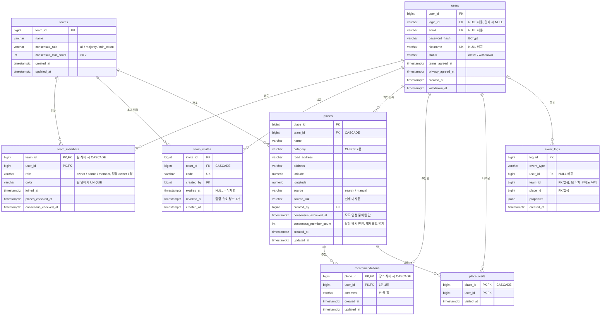
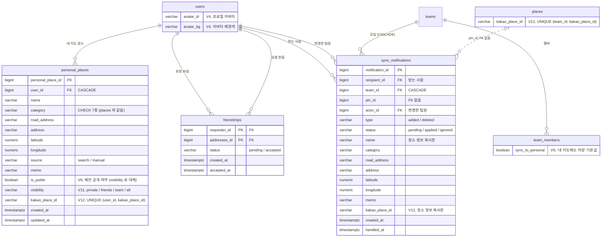

# PinMate ERD

> 기준: `backend/src/main/resources/db/migration/V1` ~ `V12` (2026-11-04). 1장은 처음 스키마(V1), 2장은 그 뒤에 추가된 것입니다. 컬럼 설명은 Drive `02.설계/PinMate_DB 정의서`에 있습니다.
> GitHub에서 이 파일을 열면 다이어그램이 그림으로 보입니다.

## 1. 처음 스키마 (V1)

### 관계에서 눈여겨볼 점

| 관계 | 설명 |
|---|---|
| `teams` → `team_members`, `team_invites`, `places` | 팀을 지우면 함께 지워짐 (`ON DELETE CASCADE`) |
| `places` → `recommendations`, `place_visits` | 장소를 지우면 함께 지워짐. 추천이 0명이 돼도 장소는 남음 (`place_visits` 는 지금 쓰지 않음) |
| `team_members` 행 삭제 | 팀 탈퇴·내보내기. `recommendations`·`place_visits` 는 남음('떠난 멤버') |
| `users` | 탈퇴해도 행을 지우지 않고 `status = withdrawn` (FK가 깨지지 않게) |
| `event_logs` | `team_id`·`place_id` 에 FK가 없음. 대상이 지워져도 로그는 남김 (현재 기록 코드 없음) |

## 2. 추가된 스키마 (V4 ~ V12: 아바타 · 내 지도 · 친구 · 동기화 알림 · 카카오 장소 ID)

> 설계 배경: [personal-map.md](personal-map.md). 아래 그림은 새로 생기거나 바뀐 부분과 그 이웃만 그립니다.

| 변경 | 이유 |
|---|---|
| `personal_places` | 내 지도(F-66, F-67). 모임 장소(`places`)와 섞지 않아야 추천·모두 인정 규칙이 개인 장소에 걸리지 않음 |
| `personal_places.visibility` | 친구·모임원에게 보여 줄 범위. `is_public` 은 V11에서 `visibility` 로 옮겼고 컬럼만 남아 있음 |
| `friendships` | 친구 요청·수락. 같은 두 사람 사이에는 방향과 상관없이 한 행만 (`LEAST/GREATEST` UNIQUE), 나 자신은 불가 |
| `team_members.sync_to_personal` | 모임마다, 사람마다 '내 지도에도 저장' 기본값 |
| `sync_notifications` | 동기화 알림(F-71, F-72). 받는 사람마다 한 행이라 사람별 반영·무시 상태를 따로 가짐 |
| `kakao_place_id` (V12) | 같은 가게 판별 키(F-36). 값이 있는 행끼리만 UNIQUE 라 기존 행(NULL)·직접 찍은 핀은 '이름 + 50m' 로 판별 |
| `sync_notifications.pin_id` FK 없음 | 모임 장소가 삭제된 뒤에도 '삭제됨' 알림을 보여 줘야 해서. 장소 정보는 행에 복사해 둠 |

### 아직 안 한 것

| 제안 | 내용 |
|---|---|
| 기존 행 `kakao_place_id` 채우기 | V12 이전 장소는 NULL. 다시 검색해 채우는 작업은 하지 않음 |
| `places.source_link` 삭제 | 네이버 검색 링크용으로 만들었지만 쓰지 않음 |
