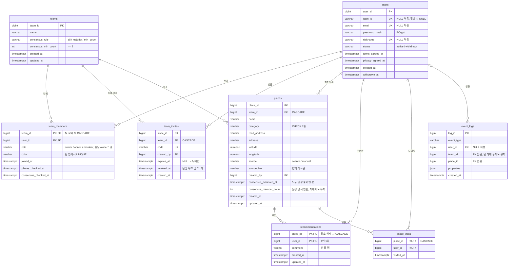
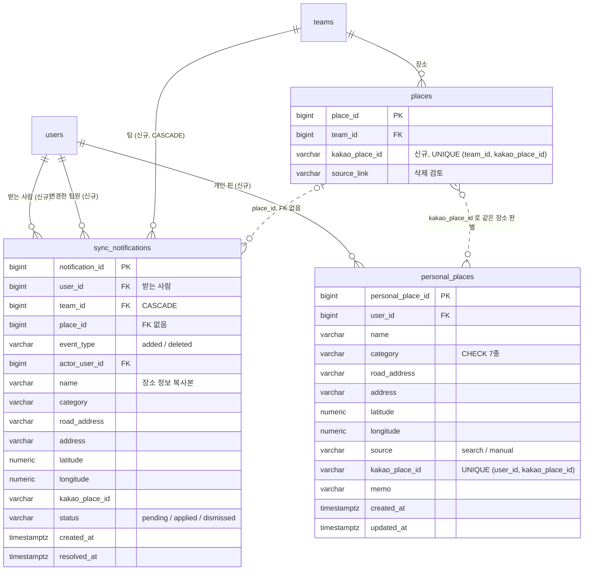

# PinMate ERD

> 기준: `backend/src/main/resources/db/migration/V1__init_schema.sql` (2026-10-27). 컬럼 설명은 Drive `02.설계/PinMate_DB 정의서`에 있습니다.
> GitHub에서 이 파일을 열면 다이어그램이 그림으로 보입니다.

## 1. 현재 스키마

### 관계에서 눈여겨볼 점

| 관계 | 설명 |
|---|---|
| `teams` → `team_members`, `team_invites`, `places` | 팀을 지우면 함께 지워짐 (`ON DELETE CASCADE`) |
| `places` → `recommendations`, `place_visits` | 장소를 지우면 함께 지워짐. 마지막 추천 취소 시 장소 삭제(F-38) |
| `team_members` 행 삭제 | 팀 탈퇴·내보내기. `recommendations`·`place_visits` 는 남음('떠난 멤버') |
| `users` | 탈퇴해도 행을 지우지 않고 `status = withdrawn` (FK가 깨지지 않게) |
| `event_logs` | `team_id`·`place_id` 에 FK가 없음. 대상이 지워져도 로그는 남김 (현재 기록 코드 없음) |

## 2. 제안 반영 후 (개인 지도 · 동기화 알림 · 같은 장소 판별)

> **상태: 제안 — 미구현.** 설계 설명: [personal-map.md](personal-map.md). 아래 그림은 바뀌거나 새로 생기는 부분과 그 이웃만 그립니다.

| 변경 | 이유 |
|---|---|
| `personal_places` 신규 | 개인 지도(F-66, F-67). 팀 장소(`places`)와 섞지 않아야 추천·모두 인정 규칙이 개인 핀에 걸리지 않음 |
| `places.kakao_place_id` 추가 | 같은 장소 판별(F-36)과 개인 핀 ↔ 팀 장소 연결(F-68 ~ F-72) 공용 키. 부분 UNIQUE로 동시 등록 중복도 DB에서 막음 |
| `sync_notifications` 신규 | 동기화 알림 탭(F-71, F-72). 받는 사람마다 한 행이라 사람별 반영·무시 상태를 따로 가짐 |
| `sync_notifications.place_id` FK 없음 | 팀 장소가 삭제된 뒤에도 '삭제됨' 알림을 보여 줘야 해서. 장소 정보는 행에 복사해 둠 |
