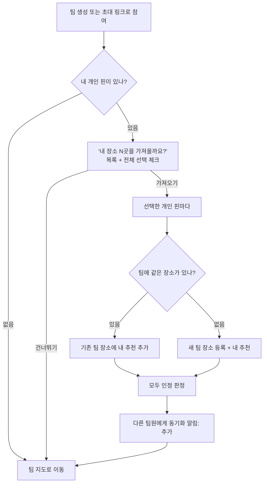
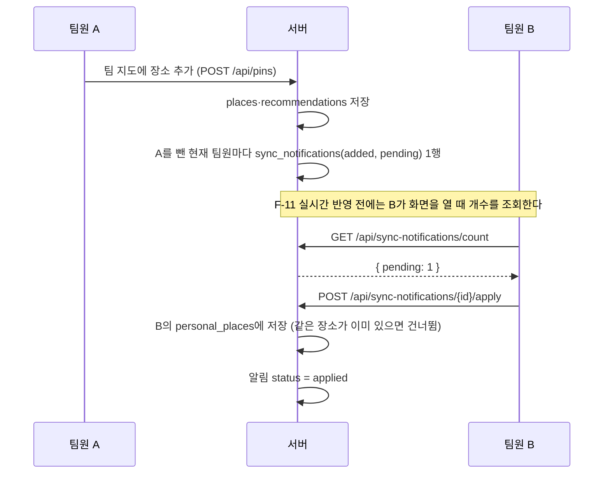

# 개인 지도 · 동기화 알림 탭 설계 (초안)

> **상태: 제안 — 팀 검토 전.** 아래 내용은 아직 구현되지 않았습니다. `[결정 필요]` 표시는 팀이 정해야 하는 항목입니다.
> 관련 문서: [API 명세서](api.md) "제안 API", [ERD](erd.md) "제안 반영 후", Drive `01.기획/기능 목록` F-66 ~ F-72, `02.설계/PinMate_DB 정의서`

## 1. 배경

프로젝트 개요서의 핵심 가치 중 "개인 지도 주권 보장(동기화 알림 탭)"이 기능 목록·DB 정의서·코드 어디에도 없었습니다. 2026-10-27 팀 결정으로 MVP에 포함합니다.

- 팀을 만들거나 참여하면 내가 개인 지도에 모아 둔 장소를 팀 지도로 가져온다.
- 팀 지도에서 추가·삭제할 때, 내 개인 지도에도 반영할지 내가 고른다.
- 다른 팀원이 팀 지도를 바꾸면 그 내역이 **동기화 알림 탭**에 쌓이고, 내 개인 지도에 반영할지 무시할지 내가 고른다.
- 팀 지도의 변경이 개인 지도를 **자동으로 덮어쓰지 않는다.**

## 2. 용어

| 용어 | 뜻 | 저장 위치 |
|---|---|---|
| 개인 핀 | 나만 보는 내 장소 | `personal_places` (신규) |
| 팀 장소 | 팀 지도에 있는 장소. 등록 = 첫 추천 | `places` + `recommendations` (기존) |
| 같은 장소 | 카카오 장소 ID가 같거나, 직접 찍은 핀은 이름이 비슷하고 50m 이내 | `kakao_place_id` 컬럼 (신규) |
| 동기화 알림 | 다른 팀원의 팀 장소 추가·삭제 내역. 받는 사람마다 한 행 | `sync_notifications` (신규) |

## 3. 기능 (기능 목록 F-66 ~ F-72)

| ID | 기능 | 완료 조건 |
|---|---|---|
| F-66 | 개인 지도 보기 | 하단 탭 또는 팀 선택에서 '내 지도'로 전환 / 내 개인 핀만 표시 / 팀 지도와 같은 카테고리 마커·필터 |
| F-67 | 개인 핀 등록·수정·삭제 | 팀 장소 등록과 같은 검색·직접 찍기 / 메모 / 다른 사람에게 보이지 않음 |
| F-68 | 팀 지도로 개인 핀 가져오기 | 팀 생성·참여 직후 '내 장소 N곳을 가져올까요?' / 가져오면 같은 장소는 내 추천으로 합치고, 없으면 새 팀 장소로 등록 / 나중에 팀 메뉴에서 다시 가져오기 가능 |
| F-69 | 팀 지도 추가 시 개인 지도 동시 저장 | 장소 추가·나도 추천 화면에 '내 지도에도 저장' 선택 |
| F-70 | 팀 지도 삭제 시 개인 지도 동시 삭제 | 추천 취소·장소 삭제 시, 내 개인 지도에 같은 장소가 있으면 '내 지도에서도 삭제' 선택 |
| F-71 | 동기화 알림 탭 | 다른 팀원의 장소 추가·삭제 내역을 팀별로 모아 표시 / 처리 안 한 개수 배지 |
| F-72 | 동기화 알림 반영·무시 | 항목별 '내 지도에 담기'(추가) · '내 지도에서도 삭제'(삭제) · '무시' / 팀 단위 모두 반영·모두 무시 |

## 4. 흐름

### 4.1 팀 참여 시 개인 핀 가져오기 (F-68)

- `[결정 필요]` **가져오는 범위**: 개요서는 "자동 합산", 시나리오 1은 "강릉 관련 핀들"입니다. 전부 자동으로 가져오면 여행 팀에 동네 맛집까지 섞입니다.
  - 제안: 확인 화면에서 **전체 선택된 상태로** 보여 주고, 사용자가 빼고 싶은 것만 해제합니다. 지역(지도 영역)으로 거르는 기능은 2차.
- 가져온 핀의 한 줄 평은 개인 핀의 메모를 그대로 씁니다.

### 4.2 팀 지도에서 추가·삭제할 때 (F-69, F-70)

- 장소 추가 화면과 '나도 추천' 버튼에 **[ ] 내 지도에도 저장** 체크박스를 둡니다.
  - `[결정 필요]` 기본값. 제안: **꺼짐**. 여행 팀처럼 일회성 장소가 많을 때 개인 지도가 지저분해지는 것을 막는 것이 개요서의 의도입니다.
- 추천 취소·장소 삭제 시, **내 개인 지도에 같은 장소가 있을 때만** [ ] 내 지도에서도 삭제 체크박스를 보여 줍니다. 기본값 꺼짐.
- 마지막 추천자가 취소해서 팀 장소가 삭제되는 경우(F-38)에도 같은 체크박스를 씁니다.

### 4.3 동기화 알림 탭 (F-71, F-72)

- **알림을 만드는 이벤트**
  - `added`: 팀에 **새 장소가 생겼을 때**(등록, 개인 핀 가져오기로 새로 생긴 장소). 받는 사람: 행위자를 뺀 현재 팀원 전원.
  - `deleted`: 팀 장소가 **삭제됐을 때**(owner 삭제, 마지막 추천 취소). 받는 사람: 행위자를 뺀 현재 팀원 중 **개인 지도에 같은 장소가 있는 사람만**.
  - 이미 있는 장소에 '나도 추천'한 것은 새 장소가 아니므로 알림을 만들지 않습니다. `[결정 필요]`
- **정리 규칙**: 장소가 삭제되면, 그 장소에 대해 아직 처리하지 않은(`pending`) `added` 알림은 지웁니다. 담을 대상이 사라졌기 때문입니다.
- **알림에는 장소 정보를 복사해 둡니다**(이름·카테고리·주소·좌표·카카오 장소 ID). 팀 장소가 지워진 뒤에도 알림을 보여 주고 반영할 수 있어야 하기 때문입니다.
- **반영(apply)**
  - `added` → 내 `personal_places`에 저장. 같은 장소가 이미 있으면 저장하지 않고 `applied` 처리.
  - `deleted` → 내 `personal_places`에서 같은 장소 삭제.
- **실시간**: F-11(WebSocket)이 구현되면 알림 생성 시 받는 사람에게 `sync_notification_created` 이벤트를 보내 배지를 즉시 올립니다. 그 전에는 화면 진입·팀 전환 때 개수를 조회합니다.

## 5. 데이터 (DB 정의서 "제안" 표시 항목)

### 5.1 `personal_places` (신규)

| 필드 | 타입 | 제약 | 설명 |
|---|---|---|---|
| personal_place_id | BIGINT | PK (IDENTITY) | |
| user_id | BIGINT | FK users, NOT NULL | 주인 |
| name | VARCHAR(100) | NOT NULL | |
| category | VARCHAR(20) | NOT NULL, CHECK 7종 | places.category 와 같은 값 |
| road_address | VARCHAR(200) | NULL | |
| address | VARCHAR(200) | NULL | |
| latitude | NUMERIC(10,7) | NOT NULL | |
| longitude | NUMERIC(10,7) | NOT NULL | |
| source | VARCHAR(10) | NOT NULL, CHECK (search/manual) | |
| kakao_place_id | VARCHAR(30) | NULL | 검색 등록이면 카카오 장소 ID |
| memo | VARCHAR(100) | NULL | 나만 보는 메모 (팀으로 가져가면 한 줄 평) |
| created_at / updated_at | TIMESTAMPTZ | NOT NULL, DEFAULT now() | |

- 부분 UNIQUE `(user_id, kakao_place_id) WHERE kakao_place_id IS NOT NULL` — 같은 장소를 두 번 저장하지 않게.
- 인덱스 `(user_id)`.

### 5.2 `places.kakao_place_id` (컬럼 추가, F-36과 공용)

| 필드 | 타입 | 제약 | 설명 |
|---|---|---|---|
| kakao_place_id | VARCHAR(30) | NULL | 검색 등록이면 카카오 장소 ID. 같은 장소 판별 키 |

- 부분 UNIQUE `(team_id, kakao_place_id) WHERE kakao_place_id IS NOT NULL` — 두 사람이 동시에 같은 장소를 등록해도 DB에서 한 행만 남게.
- 기존 `source_link`(네이버 검색 링크용, 현재 미사용)는 삭제를 검토합니다. 카카오 상세 URL은 `https://place.map.kakao.com/{kakao_place_id}`로 만들 수 있습니다.

### 5.3 `sync_notifications` (신규)

| 필드 | 타입 | 제약 | 설명 |
|---|---|---|---|
| notification_id | BIGINT | PK (IDENTITY) | |
| user_id | BIGINT | FK users, NOT NULL | 받는 사람 |
| team_id | BIGINT | FK teams ON DELETE CASCADE, NOT NULL | 팀이 지워지면 알림도 삭제 |
| place_id | BIGINT | NULL, FK 없음 | 팀 장소. 삭제된 뒤에도 알림이 남아야 해서 FK를 걸지 않음 (event_logs와 같은 방식) |
| event_type | VARCHAR(10) | NOT NULL, CHECK (added/deleted) | |
| actor_user_id | BIGINT | FK users, NOT NULL | 변경한 팀원 |
| name, category, road_address, address, latitude, longitude, kakao_place_id | (personal_places와 같음) | | 이벤트 시점의 장소 정보 복사본 |
| status | VARCHAR(10) | NOT NULL, DEFAULT 'pending', CHECK (pending/applied/dismissed) | |
| created_at | TIMESTAMPTZ | NOT NULL, DEFAULT now() | |
| resolved_at | TIMESTAMPTZ | NULL | 반영·무시한 시각 |

- 인덱스 `(user_id, status)` — 배지 개수와 목록 조회용.
- 받는 사람마다 한 행을 만드는 방식(fan-out)입니다. 팀이 2~6명이라 행 수 부담이 작고, 사람마다 반영·무시 상태를 따로 가질 수 있습니다.

## 6. API (요약 — 상세는 [api.md](api.md) "제안 API")

| 메서드 | 경로 | 설명 |
|---|---|---|
| GET | `/api/me/places` | 내 개인 핀 목록 |
| POST | `/api/me/places` | 개인 핀 등록 |
| PATCH | `/api/me/places/{id}` | 이름·카테고리·메모 수정 |
| DELETE | `/api/me/places/{id}` | 삭제 |
| GET | `/api/teams/{teamId}/import-candidates` | 가져올 수 있는 내 개인 핀 (팀에 이미 있는지 표시) |
| POST | `/api/teams/{teamId}/import` | 선택한 개인 핀을 팀으로 가져오기 |
| POST | `/api/pins` | (변경) `kakaoPlaceId`, `alsoPersonal` 추가 |
| POST | `/api/pins/{pinId}/recommend` | (변경) 본문 `alsoPersonal` 추가 |
| DELETE | `/api/pins/{pinId}` | (변경) `?alsoPersonal=true` 추가 |
| GET | `/api/sync-notifications` | 내 알림 목록 (`status`, `teamId` 거르기) |
| GET | `/api/sync-notifications/count` | 처리 안 한 개수 (배지) |
| POST | `/api/sync-notifications/{id}/apply` · `/dismiss` | 항목별 반영·무시 |
| POST | `/api/sync-notifications/apply-all` · `/dismiss-all` | 팀 단위 일괄 처리 |

## 7. 확인·결정이 필요한 것

| 구분 | 내용 |
|---|---|
| 결정 | 4.1 가져오는 범위 (전체 선택 후 해제 제안) |
| 결정 | 4.2 '내 지도에도 저장' 기본값 (꺼짐 제안) |
| 결정 | 4.3 '나도 추천'도 알림을 만들지 (만들지 않음 제안) |
| 결정 | 개인 지도를 팀 지도 화면의 한 탭으로 둘지, 별도 화면으로 둘지 |
| 확인 | 카카오 JS SDK `services.Places` 결과에 REST와 같은 `id` 필드가 오는지 (REST 문서에는 `id`·`place_url` 있음, SDK 결과 필드는 문서에 없음) |
| 확인 | 카카오 장소 ID가 시간이 지나도 바뀌지 않는지 (공식 문서에 명시 없음) |
